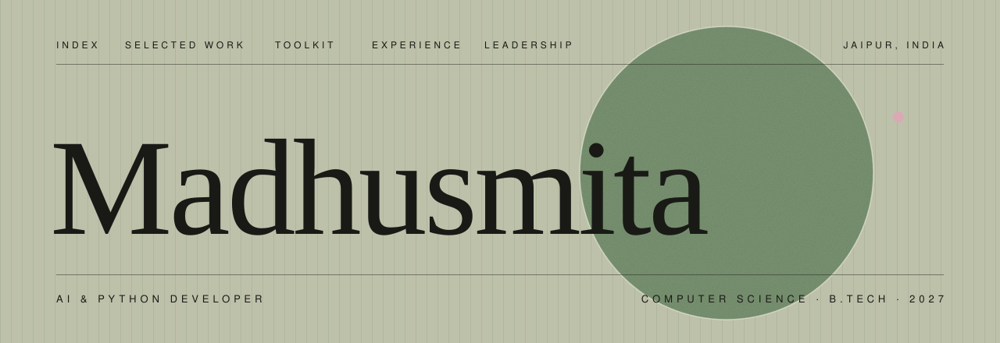
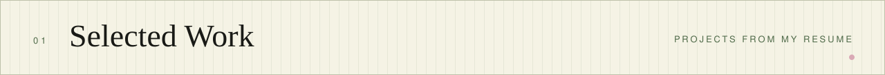
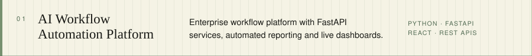
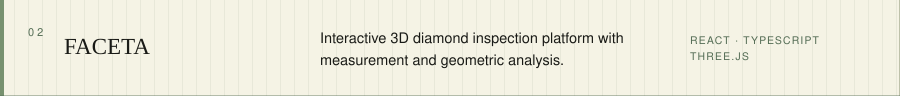
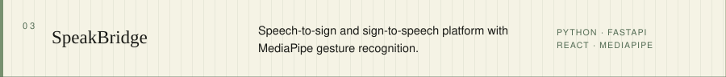
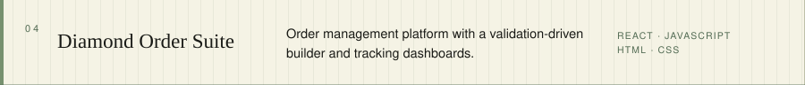
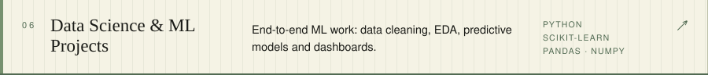
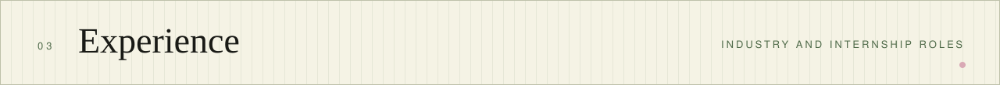
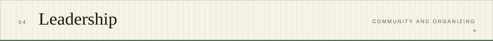

  

Computer Science undergraduate (B.Tech, Amity University Rajasthan, 2027) and AI/Python developer. I build AI-powered applications, backend services and workflow automation, with a focus on clean, production-minded code. Most recently an AI Developer & Workflow Automation Specialist at Excellent Facets.

  <a href="mailto:madhusmita9015@gmail.com">Email</a> &nbsp;·&nbsp;
  <a href="https://www.linkedin.com/in/madhusmita-p1114/">LinkedIn</a> &nbsp;·&nbsp;
  Jaipur, India

 

 

| | |
|---|---|
| **Languages** | Python, Java, C++, C, SQL, JavaScript (ES6), TypeScript |
| **AI & Data** | Machine learning, NLP, Generative AI, LLM API integration, prompt engineering, RAG fundamentals; Pandas, NumPy, Matplotlib, Scikit-learn, MediaPipe |
| **Backend** | FastAPI, Flask, REST APIs, Streamlit |
| **Frontend** | React.js, Vite, Tailwind CSS, HTML5, CSS3, Three.js |
| **Databases** | MySQL, PostgreSQL, SQLite, MongoDB |
| **Practices** | OOP, DSA, async/await, unit testing, error handling and logging, Git workflows |

 

**AI Developer & Workflow Automation Specialist** · Excellent Facets Pvt. Ltd., Jaipur · *Jun – Aug 2026*

- Built AI-powered workflow automation systems in production-grade Python to replace manual business processes.
- Designed backend services and REST APIs; integrated LLM APIs with error handling, logging, caching and cost optimization.
- Developed dashboards, data pipelines and modular ERP components in collaboration with stakeholders.

**Data Science Intern** · Upflairs Pvt. Ltd. · *Jun – Jul 2025*

- Built end-to-end ML solutions with Scikit-learn, from data cleaning and feature engineering to EDA.
- Created analytical dashboards with Pandas, NumPy and Matplotlib.

 

- **General Secretary**, IEEE Student Branch, Amity University Rajasthan · *Jan 2025 – Present*
- **Organizer**, Whack Hackathon 4.0 (national level, 24 hours) · *Feb 2026* · 30+ teams, 500+ attendees
- **Team Member**, National Service Scheme (NSS)

Certifications: Data Science with ML & AI (Upflairs) · Tata Cybersecurity Analyst Job Simulation (Forage) · NSDC Data Science & Analytics (Internshala Trainings)
