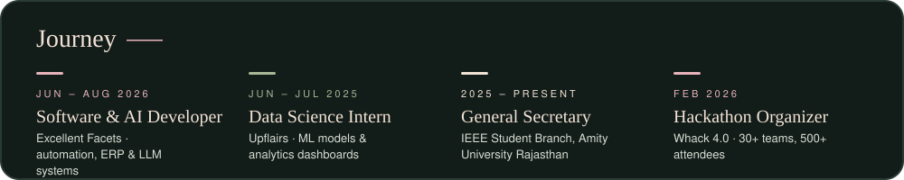
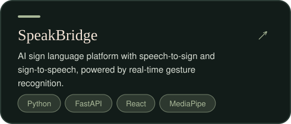
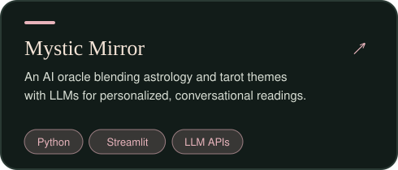
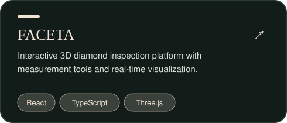
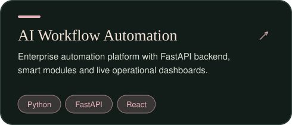
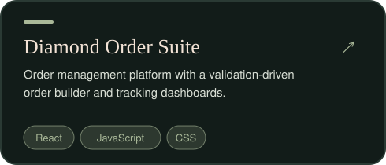
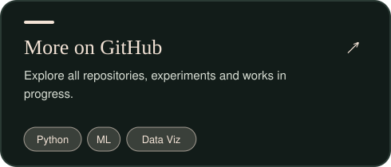

<h2 align="center">Featured Projects</h2>

<table align="center">
<tr>
<td></td>
<td></td>
</tr>
<tr>
<td></td>
<td></td>
</tr>
<tr>
<td></td>
<td></td>
</tr>
</table>

<a href="https://github.com/Madhusmita9015?tab=repositories"><b>View all repositories →</b></a> &nbsp;·&nbsp; <a href="https://linkedin.com/in/madhusmita-p1114/"><b>LinkedIn →</b></a>

